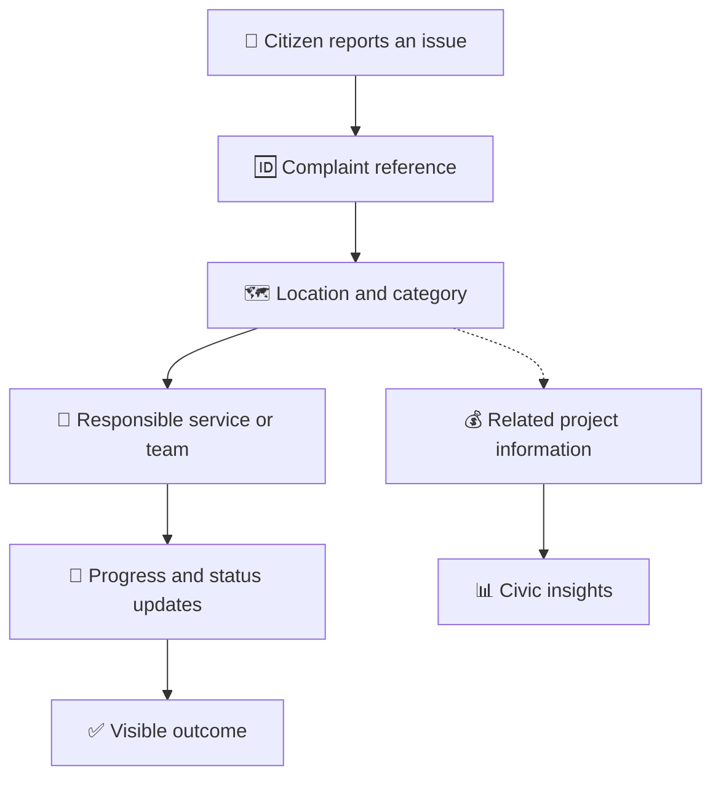
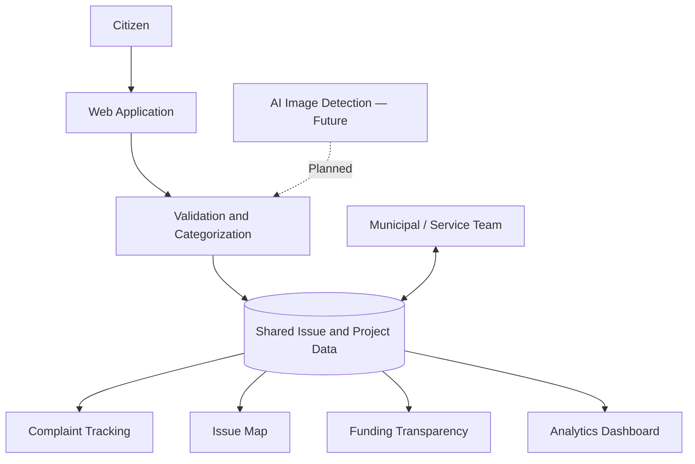

<div align="center">

#    K-Drishti
 

### Connecting Citizens · Streamlining Services · Transforming Kanpur

**Every citizen complaint, tracked from submission to visible resolution.**

A district-focused civic visibility platform for Kanpur, Uttar Pradesh.


</div>

---

## 🌆 About the Project

**K-Drishti** combines **K** for *Kanpur* and **Drishti** for *Vision*.

K-Drishti aims to make district-level civic issues easier to report, locate, route, and track. It also aims to help residents understand which municipal services they can use and how to follow their complaints.

The central problem is what happens after a citizen presses **Submit**: which service receives the complaint, who is responsible for the next step, and how can the citizen see progress?

> 💡 Our vision: Turn a complaint that disappears into a civic process that citizens and authorities can follow.

## 🎯 Problem Statement

Residents may experience difficulties when accessing municipal services:

- 🧭 **Service confusion:** Citizens may not know which department handles their issue.
- 👤 **Unclear ownership:** Responsibility for a complaint may not be visible.
- 🔎 **Limited tracking:** Residents need understandable updates after submitting a report.
- 🗺️ **Fragmented information:** Issue locations, categories, and statuses need a shared view.
- 💰 **Limited spending visibility:** Related project and expense information can be difficult to understand without accessible, verified records.

K-Drishti proposes a connected civic platform to improve visibility, routing, and accountability.

## ✨ Key Features

### 📝 1. Civic Issue Reporting
- Submit details about local civic issues.
- Include a category, description, location, and photo where supported.
- Provide relevant information to help the responsible team review the report.

### 🆔 2. Complaint Tracking
- Associate complaints with a reference ID.
- Present complaint status and progress updates.
- Help residents understand what happens after submission.

### 🗺️ 3. Interactive Kanpur Issue Map
- Display civic issues by location.
- Support category and status filters where implemented.
- Help users explore nearby reports and understand local patterns.

### 🏢 4. Service and Department Routing
- Help identify the appropriate municipal service.
- Connect issues with the responsible department, zone, or team where information is available.
- Make responsibility and next steps easier to understand.

### 💰 5. Funding Transparency
- Present related budgets, expenses, and verification status as a proposed capability.
- Help residents understand public-project information when verified records are available.

### 📊 6. Civic Analytics
- Show complaint status summaries and categories.
- Support visibility into pending and resolved issues.
- Provide a foundation for future project-progress analytics.

### 🤖 7. AI-Assisted Issue Detection — Future Scope
- Explore image-based pothole detection.
- Identify potential road-work zones.
- Surface detected issues on a map for awareness and planning.

> **Note:** AI-assisted camera detection is a planned capability, not a claim about the current implementation. Charts and funding figures shown in the project presentation use illustrative demo data, not verified Kanpur municipal statistics.

## 🔄 How K-Drishti Works



**The civic loop:** Report → Locate → Assign → Track → Understand.

## 🏗️ Conceptual Architecture



This diagram describes the proposed system architecture, not a verified inventory of the current codebase.

## 🛣️ Development Roadmap

### Phase 1 — Core Civic Experience
- Responsive reporting interface.
- Complaint reference and tracking.
- Issue map and filters.
- Seeded demonstration records.

### Phase 2 — Transparency and Analytics
- Funding and expense views.
- Project verification workflows.
- Expanded analytics.
- Support for more wards and civic services.

### Phase 3 — Intelligent Civic Insights
- AI-assisted pothole detection.
- Potential road-work-zone detection.
- Map-based issue awareness and planning.

## 🧪 Demo Data and Transparency

The project presentation identifies its charts and funding figures as **illustrative demo data**.

They should not be interpreted as official municipal records, verified budgets, or real Kanpur district performance statistics.

A real-world deployment would require verified data sources, appropriate privacy controls, clear responsibility for complaints, and coordination with the relevant authorities.

## 🚀 Run Locally

The prototype has been referenced at `http://localhost:5173/`. This is a local development address, not a public deployment URL.

Clone the repository:

```bash
git clone <YOUR_REPOSITORY_URL>
cd <YOUR_PROJECT_FOLDER>
```

For an npm-based project, the following commands may apply if they match the scripts in your `package.json`:

```bash
npm install
npm run dev
```

Open the local address printed by the development server.

> ⚙️ Setup instructions are provisional until checked against the actual repository files. Use the package manager and commands specified by your project. Keep API keys and secrets out of GitHub.

## 🖥️ Suggested Demo Flow

1. Open the K-Drishti homepage.
2. Submit a sample civic issue.
3. Show the complaint reference and details.
4. Explore the issue map and available filters.
5. Demonstrate a status update if supported by the current build.
6. Present funding or analytics views, identifying illustrative data clearly.

Only demonstrate features that actually work in the current prototype. Label incomplete features as planned or under development.

## 👥 Team SYNAPSE

| Team Member | Role |
|---|---|
| Ashish | Team SYNAPSE |
| Aseem Singh Gaur | Team SYNAPSE |
| Ruthvik | Team SYNAPSE |
| Hitesh | Team SYNAPSE |


## 🌱 Future Vision

K-Drishti aims to make civic services more accessible and understandable by connecting residents, local issues, responsible teams, progress updates, and relevant public-project information.

Our goal is to help build a Kanpur where every civic issue has a clearer path from reporting to resolution.

<div align="center">

### 👁️ K-Drishti

**Your City. Your Voice. Your Vision.**

*Together for a better Kanpur.*

</div>

---

## SCREENSHOTS
- Light Mode :


- Dark Mode :


- AI Integrated Camera detecting & mapping system:


- City Services to avail(for citizens):


- City Analytics (shows issues count and resolved data):


- Funding & Transparency (general data):


- Report an Issue(register complaints of citizens):


- Track complaints (allows Citizen and Government to track either resolved or till when):


---
## ✍️ Author

**- Aseem Singh Gaur**
